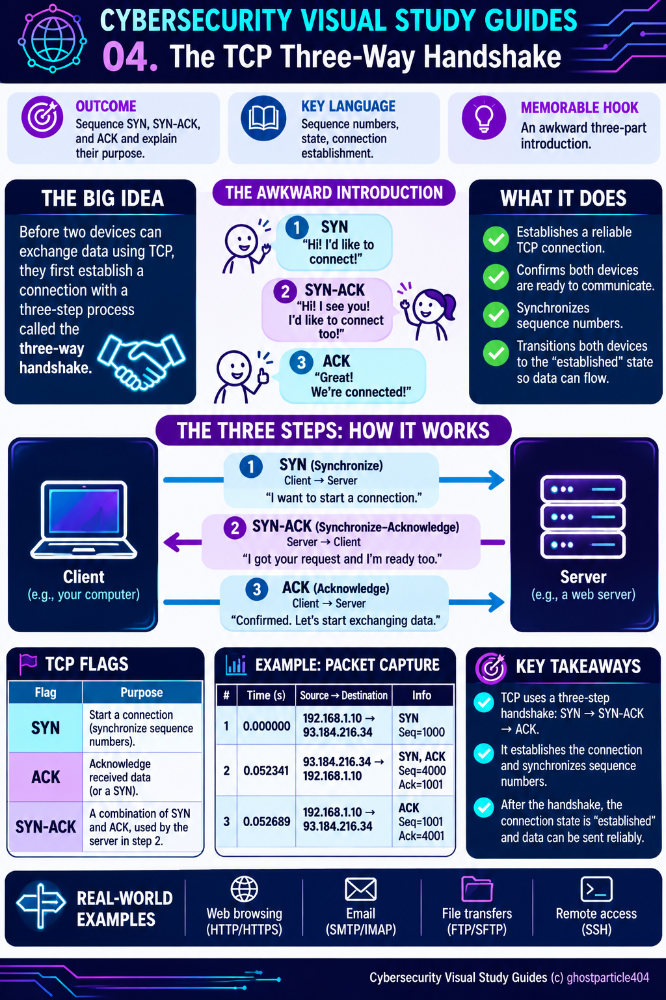

# 04 — The TCP Three-Way Handshake

**Cybersecurity Visual Study Guides · Networking Fundamentals · Guide 04 of 60**  
**Estimated time:** 25–35 minutes  
**Prerequisites:** [TCP vs. UDP](03-tcp-vs-udp.md) and basic IP addressing  
**Learning outcome:** Sequence SYN, SYN-ACK, and ACK, explain what each accomplishes, and recognize the exchange in a packet capture.

> **The big idea:** Before a TCP client and server exchange application data, they ordinarily agree to establish a connection through three messages: **SYN → SYN-ACK → ACK**.

## Why This Matters

A website refuses to load. Is the server unreachable? Is a firewall blocking the connection? Or did TCP connect successfully and the problem occur later? Recognizing the three-way handshake helps you distinguish a connection-establishment problem from an application problem. It is foundational for reading packet captures, investigating network failures, and understanding some denial-of-service attacks.

## What You'll Be Able to Do

By the end of this lesson, you should be able to:

1. Put **SYN**, **SYN-ACK**, and **ACK** in the correct order and identify their directions.
2. Explain how each endpoint announces its initial sequence number and acknowledges the other's.
3. Recognize the **SYN-SENT**, **SYN-RECEIVED**, and **ESTABLISHED** states in a simplified handshake.
4. Identify a successful handshake or a likely failure from a short packet-capture trace.
5. Distinguish establishing a TCP connection from establishing TLS or sending HTTP data.

## The Awkward Three-Part Introduction

Imagine arriving at a networking event and trying to introduce yourself to someone across the room.

**You:** “Hi! Can we talk?” (**SYN**)

**Them:** “I heard you! Yes, we can talk. Can *you* hear *me*?” (**SYN-ACK**)

**You:** “Yes, I heard you too.” (**ACK**)

Now the conversation can begin. Three messages just to say hello. TCP is the person who insists on confirming the introduction before discussing anything interesting.

**What the story gets right:** Both sides participate, and each side needs to acknowledge the other's starting sequence number. **Where it breaks down:** TCP does not verify that humans are paying attention or that an application will respond correctly; the exchange establishes transport-layer state between endpoints.

## The Technical Reality: Three Steps

Assume a client opens a TCP connection to a server on destination port **443**. For this example, the client chooses an initial sequence number (ISN) of **1000**, and the server chooses **4000**.

```text
Client                                             Server
  |                                                  |
  |---- SYN       Seq=1000 ------------------------->|  1
  |                                                  |
  |<--- SYN, ACK  Seq=4000  Ack=1001 ----------------|  2
  |                                                  |
  |---- ACK       Seq=1001  Ack=4001 --------------->|  3
  |                                                  |
  |========== TCP CONNECTION ESTABLISHED ============|
```

### Step 1 — SYN: “Can we start?”

The **client sends a TCP segment with the SYN flag set**, announcing its initial sequence number. The client typically enters the **SYN-SENT** state. The destination port identifies the server service; the client's source port identifies its side of this connection.

### Step 2 — SYN-ACK: “Yes—and can you hear me?”

The **server replies with SYN and ACK set**. Its SYN announces its own initial sequence number, while its acknowledgment confirms the client's SYN: **Ack=1001**. In the usual passive-open sequence, the server enters **SYN-RECEIVED**.

### Step 3 — ACK: “Confirmed.”

The **client acknowledges the server's SYN** with **Ack=4001**. The client enters **ESTABLISHED** after sending this ACK, and the server enters **ESTABLISHED** when it receives the valid ACK. The connection can now carry application data. The final ACK may sometimes carry data, but a basic diagram shows it alone for clarity.

**Why add one?** A SYN consumes **one position in TCP sequence space**, even when it carries no application payload. That is why the acknowledgments are ISN + 1. A bare ACK with no payload does not consume a sequence number.

## Essential Language

| Term | Plain-English meaning | Why it matters |
|---|---|---|
| **TCP** | Transmission Control Protocol | Provides a reliable, ordered byte stream between endpoints. |
| **SYN** | Synchronize flag | Initiates a connection and announces a starting sequence number. |
| **ACK** | Acknowledgment flag / acknowledgment number | Indicates which byte or sequence position is expected next. |
| **SYN-ACK** | Segment with both SYN and ACK set | Responds to the client's SYN while sending the server's SYN. |
| **Sequence number (Seq)** | Position in the TCP byte sequence space | Supports ordering and retransmission. |
| **Acknowledgment number (Ack)** | Next sequence number expected from the peer | Confirms receipt of preceding sequence space. |
| **Initial sequence number (ISN)** | Starting sequence number selected by an endpoint | Each direction has its own starting point. |
| **State** | TCP's current connection phase | Helps explain what each endpoint is waiting for. |
| **Port** | 16-bit transport-layer identifier | Distinguishes services and connection endpoints. |
| **Four-tuple** | Source IP, source port, destination IP, destination port | Identifies a TCP connection in ordinary networking discussions. |

> **Important:** “Reliable” does not mean TCP can overcome every outage or that an application must succeed. TCP uses acknowledgments and retransmissions, but a connection can still time out or fail.

## What Happens After the Handshake?

The three-way handshake establishes **TCP**, not the entire web session. For a conventional HTTPS connection over TCP, the simplified sequence is:

1. DNS resolution may occur first to find an IP address.
2. The TCP three-way handshake establishes the transport connection.
3. A **TLS handshake** negotiates security over that connection.
4. The browser and server exchange **HTTP** requests and responses inside the protected channel.

Modern HTTP/3 uses **QUIC over UDP**, so it does **not** use a TCP three-way handshake. This lesson applies to TCP connections, including common HTTP/1.1 and HTTP/2 deployments.

## Read a Packet Capture Like an Investigator

Here is a **constructed teaching example**, not an actual captured network trace:

| Packet | Time (s) | Source → Destination | Flags | Seq | Ack |
|---|---:|---|---|---:|---:|
| 1 | 0.000000 | 192.0.2.10:51514 → 198.51.100.20:443 | SYN | 1000 | — |
| 2 | 0.052341 | 198.51.100.20:443 → 192.0.2.10:51514 | SYN, ACK | 4000 | 1001 |
| 3 | 0.052689 | 192.0.2.10:51514 → 198.51.100.20:443 | ACK | 1001 | 4001 |

These addresses are reserved for documentation. The sequence numbers are deliberately simple; Wireshark often displays **relative sequence numbers** (such as 0 and 1) instead of the raw numbers.

**Questions to ask while reading:** Who initiated the connection? Did the server answer? Did the client acknowledge the answer? If all three appear, what should you investigate next?

### Optional Wireshark practice

In a capture that you own or are authorized to analyze, start with this display filter:

```wireshark
tcp.flags.syn == 1
```

It finds SYN packets, including SYN-ACK responses. Select one, note its TCP stream number, and filter the complete conversation using `tcp.stream == N`, replacing `N` with that stream's number. Examine the flags and directions of the first three packets. Captures can begin mid-connection, so not every stream will show a handshake.

## Something Has Gone Terribly Wrong

**Scenario A — The silent server.** You see SYN, SYN, SYN from the client, with no SYN-ACK. The client is retrying because it has not received a valid response. Possibilities include a filtered path, an unavailable host, packet loss, or a response lost on the return path. **Do not conclude “firewall” from this trace alone.**

**Scenario B — The refusal.** You see a SYN followed by **RST, ACK** from the destination. The attempt was actively rejected or reset; one possibility is that no service is listening on the port.

**Scenario C — The introduction succeeds, but the website fails.** You see SYN → SYN-ACK → ACK, followed by a TLS alert or HTTP error. TCP connection establishment succeeded; move your investigation to the subsequent protocol exchange.

**Scenario D — A flood of introductions.** A server receives many SYNs but few final ACKs. This may be consistent with a **SYN flood**, though incomplete handshakes can have other causes. Analysts correlate traffic volume, source patterns, server state, and other evidence before reaching a conclusion.

## Common Misconceptions Worth Retiring

- **“SYN-ACK is a separate TCP flag.”** It is a TCP segment with **two flags set: SYN and ACK**.
- **“The handshake sends the website.”** No; it establishes TCP. TLS and application data typically follow.
- **“Both devices use the same sequence number.”** Each endpoint selects its **own** initial sequence number.
- **“Three packets always appear in every capture.”** A capture may start late, miss packets, show retransmissions, or contain other traffic.
- **“A completed handshake proves the application is healthy.”** It only demonstrates that TCP connection establishment succeeded at that moment.
- **“Every web connection uses TCP.”** HTTP/3 commonly uses QUIC over UDP.

## Check Your Understanding

Try answering without looking back. Then compare with the explanations below.

1. Put these in order: **ACK, SYN-ACK, SYN**. Which direction does each travel?
2. A client sends **SYN Seq=700**. What acknowledgment number should the server send for that SYN?
3. The server sends **SYN Seq=9000**. What acknowledgment number should the client's final ACK contain?
4. A trace shows **SYN → SYN-ACK → ACK → TLS alert**. Did the TCP handshake complete?
5. You see repeated SYNs with no visible reply. Name **two possible explanations** without claiming certainty.
6. What is the difference between a TCP handshake and a TLS handshake?
7. A connection is established, but the server returns **HTTP 403**. Should you begin by blaming the TCP handshake? Why or why not?
8. A browser uses HTTP/3. Would you expect a TCP three-way handshake for that HTTP/3 connection?

<details>
<summary><strong>Answer key — open after attempting the questions</strong></summary>

1. **SYN** client → server; **SYN-ACK** server → client; **ACK** client → server. The exchange establishes TCP state in both directions.
2. **701.** SYN consumes one sequence number.
3. **9001.** The client acknowledges the server's SYN by adding one to its ISN.
4. **Yes.** TCP established; the later TLS exchange encountered a problem.
5. Examples: unreachable server, packet filtering, packet loss, or missing capture visibility. The trace alone does not identify a unique cause.
6. TCP establishes a transport connection; TLS negotiates cryptographic protection and authentication for a secure channel.
7. **No.** An HTTP 403 response indicates the request reached an HTTP-speaking endpoint and was refused at the application level.
8. **No.** HTTP/3 uses QUIC over UDP rather than TCP.

</details>

## Teach It Back in 60 Seconds

Explain the handshake to someone without using the words “handshake,” “hello,” or “connection” until your final sentence. Include **SYN**, **SYN-ACK**, **ACK**, and why the acknowledgment numbers increase by one. If you can do that clearly, you've moved beyond memorizing the diagram.

## Five Takeaways to Remember Tomorrow

1. **SYN → SYN-ACK → ACK** is the standard TCP connection-establishment sequence.
2. **Both endpoints choose an initial sequence number** and acknowledge the other's SYN.
3. **SYN consumes one sequence number**, which explains the +1 acknowledgments.
4. **A completed TCP handshake does not guarantee TLS or HTTP success.**
5. **Packet captures tell a story—but missing packets do not prove a single cause.**

## Further Learning

- [RFC 9293 — Transmission Control Protocol (TCP)](https://www.rfc-editor.org/rfc/rfc9293.html) — the current consolidated TCP specification.
- [Wireshark User's Guide](https://www.wireshark.org/docs/wsug_html_chunked/) — packet inspection and display filters.
- [RFC 9000 — QUIC: A UDP-Based Multiplexed and Secure Transport](https://www.rfc-editor.org/rfc/rfc9000.html) — useful context for why HTTP/3 differs.
- **Previous guide:** [03 — TCP vs. UDP: Reliability vs. Speed](03-tcp-vs-udp.md)
- **Next guide:** [05 — IP Addresses, MAC Addresses & Ports](05-ip-mac-addresses-and-ports.md)

---

**© 2026 GhostParticle404.**
