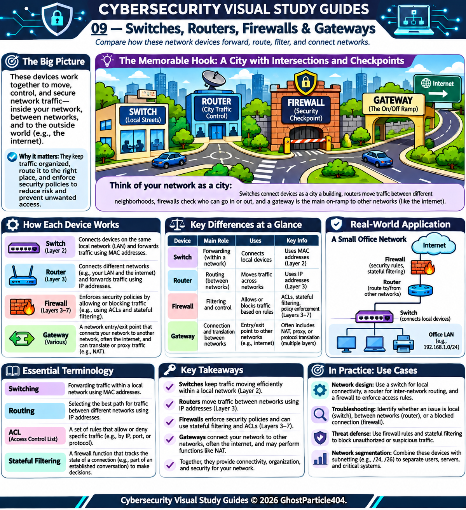

# 09 — Switches, Routers, Firewalls & Gateways

**Cybersecurity Visual Study Guides · 01 — Networking Fundamentals**  
**Estimated learning time:** 25–30 minutes, including practice

A network needs more than a collection of connected computers. It needs a way to deliver traffic locally, move traffic between networks, decide which communications are permitted, and provide a route out to other networks. This lesson shows how those jobs fit together—and why one physical device may perform several of them.

## Why this matters

Imagine a small office where staff can print documents but cannot open a website. Is the switch broken? Is the router missing a route? Is a firewall blocking HTTPS? Is the default gateway misconfigured?

Those are different failure points. Knowing which device *should* handle each step makes troubleshooting faster, firewall rules easier to reason about, and network diagrams more meaningful. The same distinctions help security analysts understand where logs and enforcement controls may exist.

## Learning objectives

By the end of this lesson, you should be able to:

1. **Identify** the primary forwarding or filtering role of a switch, router, firewall, and gateway.
2. **Trace** a packet from a workstation to a device on the same subnet and to a remote network.
3. **Explain** how MAC addresses, IP addresses, access control lists (ACLs), and stateful filtering influence traffic handling.
4. **Diagram** a small office network, marking subnet boundaries and security controls.
5. **Diagnose** plausible connectivity failures without assuming that one symptom proves a single cause.

## The big picture, in plain English

| Function | Core question | Typical mechanism |
|---|---|---|
| **Switching** | Which local port should receive this Ethernet frame? | Learns source MAC addresses and forwards frames using a MAC address table |
| **Routing** | Where should this IP packet go next? | Uses destination IP addresses and a routing table |
| **Firewall filtering** | Is this communication permitted by policy? | Evaluates rules, often using addresses, ports, protocols, interfaces, and connection state |
| **Gateway** | Where does a device send traffic destined beyond its local network—or how does one system connect to another? | A *role* that may be performed by a router, firewall, proxy, or translation service |

**Important distinction:** These are functions, not necessarily four separate boxes. A home router commonly combines switching, routing, wireless access, firewall filtering, network address translation (NAT), and default-gateway functions.

## A memorable story: a city with intersections and checkpoints

Picture a busy city. Every building has an address, streets connect neighborhoods, intersections direct cars toward their destinations, and checkpoints decide who can enter restricted areas.

- The **switch** is the local street system inside a neighborhood. It knows which local connection leads to a particular destination.
- The **router** is the intersection connecting neighborhoods. It selects the next road toward a destination outside the local neighborhood.
- The **firewall** is the security checkpoint. It checks whether the trip is allowed under established rules.
- The **gateway** is the designated exit from a neighborhood—or, in a broader sense, a connection point that may translate between different systems.

A car headed to the next building does not need to leave its neighborhood. A car headed across town needs a route. A car approaching a restricted facility may be stopped even when the road itself is perfectly navigable.

### Where the analogy stops working

Ethernet frames and IP packets are not cars, and network devices do not literally know street addresses. A switch uses MAC-address learning, a router makes IP-based forwarding decisions, and a firewall evaluates traffic against policy. A default gateway is typically an IP address configured on a host, not an additional mandatory appliance. Real devices may combine all these functions, and traffic does not necessarily traverse every function in the same order.

## Translate the story into technical reality

| Story element | Real technical concept | Why it matters |
|---|---|---|
| Local streets | Layer 2 Ethernet switching | Delivers frames between devices on the same local network or VLAN |
| Intersection | Layer 3 IP routing | Forwards packets between IP networks |
| Checkpoint | Firewall policy enforcement | Permits or denies traffic based on configured conditions |
| Neighborhood exit | Default gateway | Gives a host a next hop for off-subnet destinations |
| Translator at a border | NAT or application proxy | May change addresses or mediate communication; not required for all gateways |

## How it actually works — step by step

### 1. Switching: local delivery

An Ethernet switch operates primarily at **Layer 2 (Data Link)** of the OSI model. It learns which source **Media Access Control (MAC)** addresses appear on which ports. For a known destination MAC address, it forwards the frame toward the learned port; for certain unknown or broadcast destinations, it may flood the frame within the relevant VLAN.

Suppose workstation A (`192.168.10.20/24`) needs to contact printer B (`192.168.10.50/24`). Both are on the same IPv4 subnet. A uses Address Resolution Protocol (**ARP**) to discover the printer's MAC address if it does not already know it, then sends an Ethernet frame addressed to that MAC. The switch delivers the frame locally. **No router is required for that same-subnet exchange.**

> A switch's MAC table is not a router's IP routing table. They answer different forwarding questions.

### 2. Routing: moving between networks

A router operates primarily at **Layer 3 (Network)**. When workstation A wants to reach `203.0.113.10` (an illustrative documentation address outside its subnet), it consults its own routing information and ordinarily sends the packet to its configured **default gateway**. It uses ARP to learn the gateway interface's MAC address on an IPv4 Ethernet LAN.

The packet still carries the remote **destination IP address**. The Ethernet frame, however, is addressed to the **gateway's MAC address** for the first hop. The router receives the frame, examines the IP packet, consults its routing table, and forwards the packet toward an appropriate next hop. On ordinary IPv4 forwarding, the router also decreases the packet's Time to Live (**TTL**).

The router does not choose a route by reading a switch's MAC-address table. Each hop may use a new Layer 2 frame while the packet is forwarded toward its destination.

### 3. Firewall filtering: enforcing policy

A **firewall** evaluates traffic against security rules. A basic **access control list (ACL)** might permit or deny traffic using source and destination IP addresses, protocol, and ports. Firewall capabilities vary: some inspect only packet headers, while stateful firewalls also track information about active flows or connections.

For example, a policy could allow office workstations to initiate outbound TCP connections to destination port `443` for HTTPS while blocking unsolicited inbound connections from the internet. A **stateful** firewall can recognize returning traffic associated with an allowed connection without needing a separate broad rule permitting all inbound traffic.

Stateful filtering is **not** the same as inspecting the complete contents of an encrypted HTTPS session. More advanced inspection requires additional capabilities and, depending on the technique, appropriate decryption arrangements.

### 4. Gateway: a role rather than a universal device type

In host networking, the **default gateway** is the next-hop IP address used when no more-specific route matches a remote destination. In a typical office LAN, that address belongs to a router interface or a firewall performing routing.

The word **gateway** is also used more broadly for systems that connect unlike networks or mediate protocols, such as application gateways and proxies. **NAT** is a separate function that may be performed by a gateway device; it is not part of the definition of routing and is not required for every gateway.

### 5. Follow one office-to-internet connection

Consider this simplified example:

```text
                     INTERNET
                        |
                 [ISP connection]
                        |
              [Firewall + Router]
              LAN: 192.168.10.1/24
              (default gateway)
                        |
                  [LAN Switch]
                   /    |     \
                  /     |      \
         Workstation  Printer   Laptop
         .20/24       .50/24    .30/24

         All LAN addresses: 192.168.10.0/24
```

This drawing combines routing, firewall, and gateway functions in one edge device. That is common, but not mandatory.

**Local print job:** Workstation `.20` sends to printer `.50` on the same subnet. ARP and switching support local delivery; the default gateway is not the path for ordinary same-subnet traffic.

**Outbound website request:** Workstation `.20` sends traffic for a remote IP to gateway `.1`. The switch forwards the frame to the edge device. The edge device checks relevant firewall policy, selects a route, and may apply NAT if the network design requires it. The exact internal order of processing depends on the platform.

**Return traffic:** The edge device receives the response, applies relevant connection tracking and any reverse translation, then forwards the packet to the workstation. An allowed outbound connection does not mean all inbound traffic is allowed.

### 6. What changes when the office has VLANs?

A **virtual LAN (VLAN)** separates Layer 2 broadcast domains. Devices in different VLANs generally require **inter-VLAN routing** to exchange IP traffic, even if they connect to the same physical switch. A Layer 3 switch or router can perform this routing; a firewall can also enforce policy between VLANs when the traffic path traverses it.

For example, putting guest Wi-Fi in VLAN 20 and employee devices in VLAN 10 does **not**, by itself, guarantee that guests cannot reach employee systems. Routing and filtering policy must support the intended isolation.

## Essential terminology and language of the field

| Term | Plain-English meaning | Example or implication |
|---|---|---|
| **Switching** | Forwarding frames within a Layer 2 network | A switch delivers a frame to a local printer |
| **MAC address** | Link-layer identifier used for local frame delivery | Switches learn MAC-to-port associations |
| **Routing** | Selecting a next hop for an IP packet | Traffic leaves `192.168.10.0/24` for another network |
| **Routing table** | Information used to choose a next hop or outgoing interface | A default route covers destinations without a more-specific match |
| **Default gateway** | Host's next hop for off-subnet traffic when no better route matches | `192.168.10.1` in the example |
| **Firewall** | System enforcing network traffic policy | Blocks unauthorized inbound connections |
| **ACL (access control list)** | Ordered or otherwise platform-defined set of permit/deny conditions | Allow TCP `443` to approved destinations |
| **Stateful filtering** | Filtering informed by tracked connection or flow state | Recognizes replies to an allowed outbound TCP connection |
| **NAT (network address translation)** | Rewriting IP address information, sometimes ports, as traffic crosses a device | Many offices translate private IPv4 addresses for internet access |
| **VLAN (virtual LAN)** | Logical Layer 2 separation | Guest and employee networks occupy different broadcast domains |
| **ARP (Address Resolution Protocol)** | IPv4 mechanism for resolving a local next-hop IP to a link-layer address | Host discovers gateway MAC address |

## A realistic cybersecurity application: diagnose the small office

**Situation:** Staff can print to `192.168.10.50`, but cannot reach an approved external HTTPS service. A network analyst is asked to investigate.

**Available observations:**

1. Workstation address: `192.168.10.20/24`; configured default gateway: `192.168.10.1`.
2. Printing to `192.168.10.50` succeeds.
3. The workstation can reach the gateway's LAN interface.
4. A firewall log records a deny event for a connection from `192.168.10.20` to the approved remote service on TCP port `443`.

**Reasoning:** Successful local printing supports the conclusion that at least some local communication and switching are working. Reaching the gateway supports basic connectivity to that interface. The deny event is stronger evidence of a **policy decision affecting the observed flow** than of a broken switch. The analyst should verify the exact source, destination, port, timestamp, matching rule, and intended business policy before changing anything.

**Defensible conclusion:** The observed outbound connection was denied by firewall policy. That does not establish that every internet connection is blocked or that routing, DNS, and NAT are universally healthy.

**Possible next step:** Confirm authorization for the destination, review the matching rule and its position or precedence, and test the approved change under change-control procedures. Do not simply disable the firewall.

### Apply it: draw a two-subnet office

Extend the earlier diagram with:

- Employee LAN: `192.168.10.0/24` (workstation and printer).
- Guest LAN: `192.168.20.0/24` (guest laptop).
- An inter-VLAN routing function and a firewall policy that permits guests to access the internet but denies guest-initiated connections to the employee subnet.

On your drawing, **label** the Layer 2 segments, both gateway interfaces, where routing occurs, and where the guest-to-employee deny rule is enforced. Remember that a diagram showing a firewall somewhere in the building is not enough: the relevant traffic must actually pass through the enforcement point.

## Common misconceptions and pitfalls

| Myth | More accurate explanation |
|---|---|
| “A switch and router do the same thing.” | A conventional Ethernet switch forwards frames using MAC information; a router forwards IP packets between networks. Multilayer switches can also route. |
| “Every network needs four separate devices.” | One appliance may combine switch, router, firewall, and gateway functions. |
| “A gateway is just another name for NAT.” | A default gateway is a next hop. NAT is an optional translation function. |
| “A stateful firewall automatically understands encrypted application content.” | Connection tracking and deep content inspection are different capabilities. |
| “Putting devices in separate VLANs makes them secure.” | VLANs create Layer 2 separation; inter-VLAN routing and policy determine permitted communication. |

## Check your understanding

Try answering without looking at the glossary. Explain your reasoning for the scenario questions.

**1. Local delivery:** Two workstations are on the same IPv4 subnet and connected to the same Ethernet switch. Which function primarily forwards frames between them?

**2. Address distinction:** Which address does a conventional Ethernet switch primarily use for forwarding decisions? Which address does a router use to select a next hop?

**3. Default gateway:** A laptop at `192.168.10.30/24` needs to reach `192.168.20.50`. Why would it ordinarily send the first Ethernet frame toward its default gateway instead of directly to the destination host's MAC address?

**4. Firewall policy:** What extra information can a stateful firewall use that a simple stateless packet filter might not track?

**5. Scenario — office outage:** Employees can print locally, but an external HTTPS connection is denied in the firewall logs. Which function should you investigate first, and what evidence would you verify before making a change?

**6. Scenario — guest isolation:** Guest Wi-Fi and employee computers are placed in different VLANs. A guest still reaches an employee server. Give one plausible reason and one corrective control.

**7. Design challenge:** Sketch a network with a switch, two IP subnets, an internet connection, and a device that serves as both router and firewall. Mark the default gateway for each subnet and explain which traffic must traverse the routing function.

## Answer key with explanations

<details>
<summary>Show answers and explanations</summary>

**1. Switching.** A Layer 2 switch forwards Ethernet frames between devices on the same local network. A router is not ordinarily needed for traffic that remains on the same subnet.

**2. MAC addresses for switching; destination IP addresses for routing.** A switch uses its MAC address table to choose a local output port. A router examines the IP destination and consults routing information to choose a next hop or interface.

**3. The destination is outside the laptop's local /24 subnet.** The laptop sends the packet toward an on-link next hop, usually its default gateway. Its first Ethernet frame is addressed to the gateway's MAC, while the packet retains the remote destination IP address.

**4. Connection or flow state.** A stateful firewall can track whether traffic belongs to an established or permitted flow and use that information when evaluating return traffic. This is distinct from decrypting or understanding the application payload.

**5. Investigate the firewall decision first.** Confirm that the logged deny matches the actual attempted flow (source, destination, protocol, port, and time), identify the rule, and verify whether the connection should be authorized. Working printing suggests local connectivity is functioning for that path; it does not prove every switch or route is healthy.

**6. Inter-VLAN routing may be allowed without adequate filtering.** A Layer 3 switch or router could be forwarding between the VLANs. Apply an appropriate deny rule at an enforcement point that the guest-to-employee traffic actually crosses, while permitting explicitly authorized services as needed.

**7. One valid design:** Put employees on `192.168.10.0/24` and guests on `192.168.20.0/24`, each in a separate VLAN connected through a VLAN-capable switch. A router/firewall has gateway interfaces `192.168.10.1` and `192.168.20.1`, with a connection to the ISP. Local same-VLAN traffic is switched; traffic between the two subnets or to the internet requires routing. Firewall rules should restrict guest access to employee systems. Equivalent designs using a Layer 3 switch and a separate edge firewall are also valid if the enforcement path is correctly shown.

</details>

## Teach it back in 60 seconds

Without looking at the diagram, explain:

1. Why two devices on the same subnet can usually communicate through a switch without using a router.
2. What changes in the Ethernet frame and what remains the destination of the IP packet when a host sends traffic to its default gateway.
3. How a firewall can block traffic even when a valid route exists.
4. Why “gateway” does not necessarily mean a separate box on the network diagram.

## Key takeaways

- **Switches** primarily forward local Ethernet frames using MAC-address information.
- **Routers** forward IP packets between networks using routing information.
- **Firewalls** enforce traffic policy; stateful filtering can account for connection context.
- **Default gateways** provide a next hop for off-subnet destinations; gateway, NAT, and firewall are different concepts that may coexist on one device.
- **Secure segmentation** requires correct addressing, routing paths, and enforcement rules—not just separate VLAN labels.

## Further learning and references

**Primary references:**

- [RFC 1812 — Requirements for IP Version 4 Routers](https://www.rfc-editor.org/rfc/rfc1812)
- [RFC 826 — An Ethernet Address Resolution Protocol](https://www.rfc-editor.org/rfc/rfc826)
- [RFC 3022 — Traditional IP Network Address Translator (Traditional NAT)](https://www.rfc-editor.org/rfc/rfc3022)
- [NIST SP 800-41 Rev. 1 — Guidelines on Firewalls and Firewall Policy](https://csrc.nist.gov/pubs/sp/800/41/r1/final)

**Optional practice:** In a network simulator or authorized lab, draw two VLANs and test what happens when inter-VLAN routing is enabled with and without a restrictive firewall or ACL policy. Record the expected and observed paths rather than assuming every platform processes rules identically.

**Related guide:** [08 — Subnetting & CIDR: Visualized](08-subnetting-and-cidr.md)

---

© 2026 GhostParticle404.
