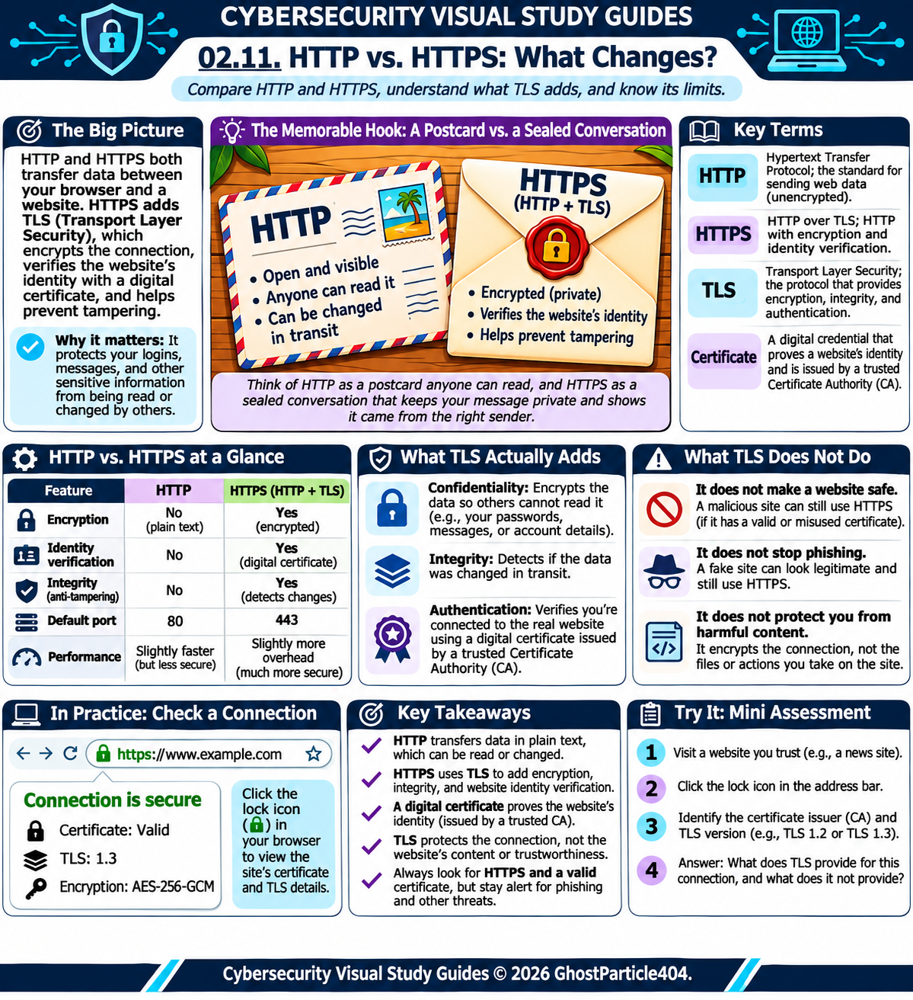

# 11 — HTTP vs. HTTPS: What Changes?

**Cybersecurity Visual Study Guides · 02 — Web & Internet Security**  
**Estimated time:** 25–30 minutes, including practice

A browser can load the same page over HTTP or HTTPS, but the security properties of those connections differ enormously. This lesson explains what Transport Layer Security (TLS) adds, what it cannot promise, and how to investigate a browser connection without mistaking a padlock for a safety guarantee.

## Why this matters

Imagine entering a password on a café Wi-Fi network. The question is not simply whether the login page looks professional: can someone observing the network read or alter the data in transit, and can your browser verify which server it is communicating with? Understanding HTTPS helps you assess those risks, troubleshoot certificate warnings, and interpret evidence during security investigations.

## Learning objectives

By the end, you should be able to:

1. **Explain** the relationship between HTTP, HTTPS, and TLS.
2. **Compare** confidentiality, integrity, and authentication on HTTP versus HTTPS connections.
3. **Trace** a simplified HTTPS connection setup, including certificate validation.
4. **Identify** what HTTPS does *not* establish about a website's content or intentions.
5. **Inspect** browser connection details and interpret common warning signs.

## The big picture, in plain English

**HTTP (Hypertext Transfer Protocol)** defines how clients and servers exchange requests and responses. **HTTPS** is HTTP protected by **TLS (Transport Layer Security)**. TLS establishes cryptographic protection for data traveling between the endpoints of the TLS connection.

TLS provides three important properties:

- **Confidentiality:** an observer on the network should not be able to read the protected HTTP content.
- **Integrity:** tampering with protected traffic is detected.
- **Authentication:** the browser checks that the server presents credentials valid for the hostname it intended to contact, subject to the trust and validation process.

HTTPS does **not** mean the website is benevolent, the downloaded file is harmless, or the organization behind a site is trustworthy.

> **Mental model:** HTTP defines the conversation. TLS protects the conversation while it travels.

## A memorable story: the postcard and the sealed conversation

You send a postcard across town. The postal workers need to know where to deliver it, but anyone handling it can also read the message. If someone changes a sentence, the recipient may have no reliable way to notice.

Now imagine a sealed, tamper-evident envelope delivered through a process that also checks the recipient's identity. Outsiders can still observe that something is being delivered, but they cannot casually read the message, and unauthorized alterations are detectable.

**HTTP is the postcard. HTTPS is the protected conversation.** The analogy helps explain why transmitting a login form over unencrypted HTTP is risky.

### Where the analogy stops working

- TLS is not a literal envelope: it uses cryptographic protocols, keys, and authenticated encryption.
- A certificate is not a character reference. It helps establish control of a hostname under a certificate-validation system; it does **not** certify that a website is honest.
- Encryption does not conceal every detail. Depending on the protocol and network configuration, observers may still learn IP addresses, traffic timing and sizes, and some connection metadata. DNS queries or hostname information may also be exposed.
- TLS protection ends at its TLS endpoints. A reverse proxy or content-delivery service may terminate TLS before forwarding traffic elsewhere.

## Translate the story into technical reality

| Story element | Real technical concept | Why it matters |
|---|---|---|
| Postcard message | Unencrypted HTTP content | Network observers may read or modify it |
| Sealed message | TLS-encrypted application data | Helps preserve confidentiality |
| Tamper-evident seal | TLS integrity protection | Detects unauthorized modifications |
| Checking the intended recipient | Certificate and hostname validation | Helps authenticate the server endpoint |
| Address visible to delivery services | Network/connection metadata | HTTPS does not make traffic invisible |

## How it actually works — step by step

### 1. HTTP: the application protocol

A browser sends a request, such as `GET /index.html`, and the server returns a response, such as `200 OK` with HTML. HTTP defines methods, headers, status codes, and message semantics. It does **not**, by itself, provide transport encryption.

### 2. HTTPS: HTTP over a protected connection

A simplified HTTPS connection using HTTP/1.1 or HTTP/2 over TCP looks like this:

```text
Browser                     Website
   |--- TCP connection -------->|
   |--- TLS ClientHello ------->|
   |<-- TLS handshake data -----|
   |   Validate certificate     |
   |<== Protected HTTP ========>|
```

The TLS handshake negotiates cryptographic parameters and establishes shared secrets. The server presents a certificate chain that the browser evaluates. In modern TLS 1.3, handshake details and message ordering are more nuanced than this sketch; the diagram is a conceptual sequence, not a packet-by-packet transcript.

**Important exception:** HTTP/3 uses QUIC over UDP, with TLS 1.3 integrated into QUIC's handshake rather than a separate TCP connection. HTTPS does not universally mean “HTTP over TCP.”

### 3. What the browser checks about the certificate

Typical certificate validation considers whether:

1. The certificate is valid for the **hostname** being visited (for example, `example.com`).
2. The certificate is within its validity period.
3. Its chain leads to a trust anchor accepted by the browser or operating system.
4. Required certificate usages and other validation requirements are satisfied.
5. Applicable revocation and browser policies are handled according to the implementation.

A certificate issued for `example.net` should not authenticate `example.com`. A certificate error can indicate misconfiguration, interception, or another problem; the warning alone does not prove an attack.

### 4. What TLS protects—and what it leaves exposed

| Property | HTTP without TLS | HTTPS with correctly validated TLS |
|---|---|---|
| HTTP request/response confidentiality | No transport encryption | Protected in transit between TLS endpoints |
| HTTP message integrity | No cryptographic transport protection | Cryptographic integrity protection |
| Server authentication | Not provided by HTTP alone | Certificate-based authentication of the intended hostname |
| Website safety | Not guaranteed | **Still not guaranteed** |
| Protection from phishing | No | **No**—phishing sites can use HTTPS |
| Protection from malware in downloads | No | **No**—malicious files can be delivered securely |

### 5. Ports and performance: useful conventions, not guarantees

HTTP commonly uses **TCP port 80** and HTTPS commonly uses **TCP port 443**; HTTPS with HTTP/3 commonly uses **UDP port 443**. These are defaults, not hard requirements. Modern TLS can be efficient, and whether HTTPS is measurably slower depends on protocol versions, connection reuse, hardware, and network conditions. Avoid the blanket claim that HTTP is always faster.

### 6. A complete example

You navigate to `https://example.com/login`:

1. The browser resolves the hostname and connects to an appropriate server endpoint.
2. A secure transport handshake establishes protection and authenticates the server hostname.
3. The browser sends the HTTP request through the protected channel.
4. The server returns the login page over that channel.
5. When you submit the form, the protected connection helps prevent a network eavesdropper from reading the password in transit.

**What this does not prove:** the login page could still belong to a phishing site whose domain you mistyped. HTTPS protects the connection to the site you reached, not your judgment about which site you meant to visit.

## Essential terminology

| Term | Plain-English meaning | Example or implication |
|---|---|---|
| HTTP | Hypertext Transfer Protocol; web request/response semantics | `GET /` and `200 OK` |
| HTTPS | HTTP carried over TLS-protected transport | `https://example.com` |
| TLS | Transport Layer Security; cryptographic channel protection | TLS 1.3 |
| Confidentiality | Preventing unauthorized reading of protected data | Password unreadable to a passive network observer |
| Integrity | Detecting unauthorized changes | Modified encrypted records fail authentication |
| Authentication | Establishing the identity of the endpoint | Browser validates the server hostname |
| Digital certificate | Signed credential binding a public key to identifying information | Certificate covers `example.com` |
| Certificate Authority (CA) | Entity that issues certificates within a trust framework | Browser trusts an accepted certificate chain |
| Certificate chain | Sequence connecting a server certificate to a trust anchor | Leaf → intermediate → trusted root |
| Hostname validation | Checking that the certificate covers the requested name | `example.net` does not automatically cover `example.com` |
| TLS termination | Point where encrypted traffic is decrypted | Reverse proxy receives HTTPS, then forwards onward |
| HSTS | HTTP Strict Transport Security; policy telling browsers to use HTTPS for a host | Helps resist certain downgrade attempts |

## Real-world cybersecurity application: inspect a browser connection

**Situation:** An employee reports that a vendor portal displays a certificate warning. You need to determine what the warning actually supports before advising them.

### Safe investigation procedure

1. Open a **known, trusted website** in a current browser. Check the full hostname and `https://` scheme.
2. Open the browser's **site information / connection details** controls. The icon and menu location vary by browser and version; a padlock is not always shown.
3. Find the **certificate details**, if the browser exposes them. Identify the hostname(s), validity dates, issuer, and any warnings.
4. If available, inspect the **security/protocol** information in developer tools. The negotiated TLS version and cipher suite may appear there, but some browsers hide or relocate these details.
5. Record the **exact warning text**, URL hostname, browser version, and time. Do not click through a certificate warning on a real login or payment page merely to finish an exercise.

### Evidence and reasoning

| Observation | Reasonable interpretation | What it does **not** prove |
|---|---|---|
| Valid certificate for the requested hostname | Browser established a connection under its certificate-validation policy | Site is ethical or malware-free |
| Hostname mismatch | Certificate does not match the requested name | An attacker is definitely present |
| Expired certificate | Validity period has ended | Traffic was necessarily intercepted |
| HTTPS shown in address bar | Connection uses HTTPS | Every embedded resource, backend hop, or user action is safe |

**Defensible conclusion:** A certificate warning warrants investigation and should not be bypassed casually. It is evidence of a validation problem, not a complete diagnosis of its cause.

## Common misconceptions and pitfalls

| Myth | More accurate explanation |
|---|---|
| “HTTPS means a website is safe.” | HTTPS protects transport; malicious websites also obtain valid certificates. |
| “A padlock means the company is legitimate.” | It indicates connection security information, not an endorsement of the business. |
| “TLS hides everything about my browsing.” | IP addresses, timing, sizes, and some metadata may remain observable. |
| “HTTPS always uses TCP.” | HTTP/3 uses QUIC over UDP with TLS 1.3. |
| “A certificate warning proves hacking.” | Expiration, hostname mismatch, configuration errors, and interception are among possible causes. |

## Check your understanding

1. **Recall:** What does HTTPS add to HTTP?
2. **Explain:** Name the three major security properties TLS provides for a connection.
3. **Interpret:** A site has a valid certificate, but its page asks you to send your banking password to an unfamiliar address. Is HTTPS evidence that the request is safe? Explain.
4. **Scenario:** Your browser warns that a certificate belongs to `portal.example.net` when you intended to visit `portal.example.com`. What is the specific validation problem, and what should you do next?
5. **Compare:** What information might a network observer still learn during an HTTPS session?
6. **Scenario:** A company terminates HTTPS at a reverse proxy and forwards requests to an application server over unencrypted HTTP. Which part of the journey is protected by the browser's TLS connection, and what additional risk should the company evaluate?
7. **Apply:** Why would “HTTPS always uses TCP port 443” be an inaccurate troubleshooting rule?

## Answer key with explanations

<details>
<summary>Show answers and explanations</summary>

**1.** HTTPS carries HTTP over TLS, adding cryptographic transport protection and server authentication. HTTP's application-level request and response concepts remain.

**2.** **Confidentiality** helps keep protected content private; **integrity** detects unauthorized changes; **authentication** helps verify the server endpoint using certificate validation. None of these establishes that the site's content is harmless.

**3.** **No.** A valid certificate supports the authenticity of the connection to the named host under the browser's trust rules. It does not prove that the site or its requests are trustworthy. Verify the domain and the request through an independent channel.

**4.** The certificate does not cover the hostname you intended to visit. Stop rather than bypassing the warning, verify the URL, and contact the organization's support or security team if necessary. A mismatch is not, by itself, proof of an attack.

**5.** Observers may still see destination IP addresses, traffic timing and sizes, and potentially DNS or hostname-related metadata, depending on the protocols and configuration. The encrypted HTTP content is not normally readable to a passive observer.

**6.** The browser-to-proxy TLS connection is protected; that does not automatically encrypt the proxy-to-application-server hop. The organization should assess that internal link's exposure and consider TLS or other appropriate protections for it.

**7.** Port 443 is a convention, not a requirement, and HTTPS can run over HTTP/3 using QUIC on UDP 443. Services can also use nondefault ports. Investigate the actual protocol and configuration instead of relying only on a port number.

</details>

## Teach it back in 60 seconds

Without looking at the lesson, explain:

1. What stays the same when a website moves from HTTP to HTTPS?
2. What does TLS add, and how does a certificate fit in?
3. Why can a phishing page have a valid HTTPS connection?
4. What would you check first if a browser reports a certificate mismatch?

Aim for a clear mental model, not a memorized definition.

## Key takeaways

- **HTTP describes web communication; HTTPS protects it with TLS.**
- **TLS adds confidentiality, integrity, and endpoint authentication**, subject to correct implementation and validation.
- **Certificates authenticate names, not good intentions.** A phishing site can have HTTPS.
- **Connection protection has boundaries:** metadata and traffic beyond the TLS endpoint may need separate safeguards.
- **Inspect the hostname and certificate warning details** before drawing security conclusions.

## Further learning and references

**Primary technical references**

- [RFC 9110 — HTTP Semantics](https://www.rfc-editor.org/rfc/rfc9110)
- [RFC 8446 — The Transport Layer Security (TLS) Protocol Version 1.3](https://www.rfc-editor.org/rfc/rfc8446)
- [RFC 5280 — Internet X.509 Public Key Infrastructure Certificate and CRL Profile](https://www.rfc-editor.org/rfc/rfc5280)
- [RFC 9114 — HTTP/3](https://www.rfc-editor.org/rfc/rfc9114)
- [RFC 6797 — HTTP Strict Transport Security (HSTS)](https://www.rfc-editor.org/rfc/rfc6797)

**Optional practice:** Inspect connection information for two familiar HTTPS sites in your browser and compare the certificate names and issuer details. Avoid sending credentials or bypassing warnings for the exercise.

**Related guide:** [06 — DNS Lookup](../01-networking-fundamentals/06-dns-url-resolution.md) — understand how a hostname is resolved before a connection is established.

---

© 2026 GhostParticle404.
