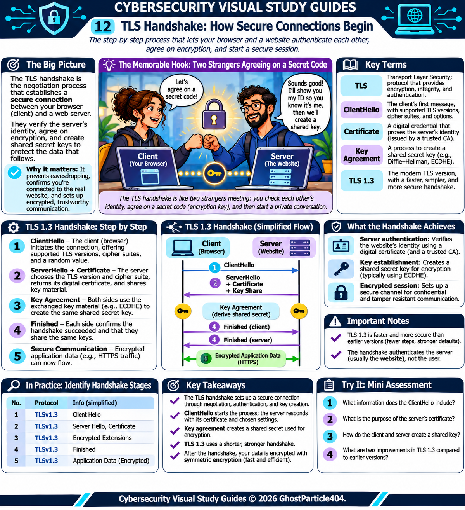

# 12 — TLS Handshake: How Secure Connections Begin

**Series:** Cybersecurity Visual Study Guides  
**Category:** 02 — Web & Internet Security  
**Estimated learning time:** 25–30 minutes, including practice  
**Prerequisite:** [Guide 11 — HTTP vs. HTTPS](11-http-vs-https.md)

Your browser can establish an encrypted connection to a website in a remarkably short time. Before it sends sensitive application data, however, it must negotiate cryptographic settings, establish keys, and verify that the server is authorized to represent the website. This lesson explains that conversation without treating encryption as magic.

## 1. Why this matters

Suppose you open your bank's website. Seeing `https://` tells you the browser intends to use HTTP over a protected connection, but **how does that connection become protected?** A TLS handshake is the setup procedure that makes secure application communication possible.

Understanding the handshake helps you interpret packet captures, investigate certificate errors, troubleshoot failed connections, and distinguish encrypted transport from a trustworthy website.

## 2. Learning objectives

By the end, you should be able to:

1. **Identify** the major messages in a typical full TLS 1.3 handshake.
2. **Explain** how a client authenticates a server using a certificate and proof of private-key possession.
3. **Describe** how ephemeral key agreement produces shared keying material without transmitting a completed secret key.
4. **Trace** which handshake messages are visible and which become encrypted.
5. **Interpret** a simplified TLS packet capture and identify plausible failure points.

## 3. The big picture, in plain English

**Transport Layer Security (TLS)** is a protocol that protects communication between endpoints. A typical browser-to-website TLS connection provides:

- **Confidentiality:** outsiders cannot read the protected application data merely by observing the network.
- **Integrity:** unauthorized changes to protected messages are detected.
- **Server authentication:** the client can verify that the server is authorized to use the requested hostname, assuming certificate validation succeeds.

The **handshake** negotiates how the endpoints will communicate securely and establishes the cryptographic keys used afterward. In **TLS 1.3**, much of the handshake itself is encrypted after the initial key exchange.

> **Scope:** This guide focuses on a normal **full TLS 1.3 handshake with certificate-based server authentication**, no client certificate, no session resumption, and no 0-RTT early data. Other valid TLS 1.3 flows differ.

## 4. The memorable hook: two strangers agreeing on a secret code

Two strangers meet at a crowded conference. They want to discuss a confidential project, but people nearby can hear them.

First, one says, “I know several ways we could communicate privately.” The other chooses an approach. They exchange information that lets **each independently work out matching secret material**—without announcing that secret to the room.

Before sharing anything sensitive, the first stranger checks the other's credentials and asks for proof that the credentials really belong to them. Finally, both confirm that the setup conversation was not altered. Only then do they begin their private discussion.

### Where the analogy stops working

- Real TLS does **not** involve people choosing a shared password or verbally agreeing on a code.
- Key agreement uses mathematical operations, not a secret phrase passed between participants.
- A server certificate is not merely an ID card: its public key, trusted certification path, hostname, validity, and related checks matter, and the server must prove possession of the corresponding private key.
- Ordinary HTTPS typically authenticates the **server**, not the human user or client device.

## 5. Translate the story into technical reality

| Story element | TLS concept | Why it matters |
|---|---|---|
| “Here are the methods I support” | **ClientHello** | Offers supported protocol and cryptographic options |
| “Let's use this method” | **ServerHello** | Selects compatible parameters and supplies the server's key share |
| Exchanging mathematical clues | **(EC)DHE key agreement** | Allows both sides to derive shared keying material |
| Checking credentials | **Certificate and certificate validation** | Binds a server identity to a public key through a trusted chain |
| Proving ownership of credentials | **CertificateVerify** | Demonstrates control of the private key corresponding to the certificate |
| Confirming the setup was not altered | **Finished messages** | Authenticates the handshake transcript |
| Starting the private conversation | **Encrypted application data** | Protects HTTP requests and responses |

## 6. How TLS 1.3 actually works — step by step

### Before the handshake: find and contact the server

The browser typically resolves the hostname and establishes a transport connection. For ordinary HTTPS over TCP, TLS runs after TCP connection establishment. HTTP/3 instead uses QUIC, which integrates TLS 1.3 differently; this lesson illustrates the familiar TLS-over-TCP case.

### Step 1 — ClientHello (client → server)

The browser sends a **ClientHello** offering, among other things:

- Supported TLS versions (including TLS 1.3).
- Supported cipher suites and cryptographic groups.
- A random value and usually an **ephemeral key share**.
- Extensions such as **Server Name Indication (SNI)** and **Application-Layer Protocol Negotiation (ALPN)**, when applicable.

**Important:** A ClientHello does not transmit the eventual application-data encryption key.

### Step 2 — ServerHello (server → client)

The server selects compatible settings and sends its **ServerHello**, normally including its own ephemeral key share. With the two key shares and each side's private ephemeral value, the client and server can independently calculate the same shared secret using an ephemeral (Elliptic Curve) Diffie–Hellman exchange, abbreviated **(EC)DHE**.

The TLS 1.3 key schedule then derives handshake traffic keys. **Messages after ServerHello are normally encrypted**, even though a packet analyzer can still identify some record boundaries and lengths.

### Step 3 — Encrypted server handshake messages (server → client)

In a typical certificate-authenticated handshake, the server sends these messages **under handshake encryption**:

1. **EncryptedExtensions:** negotiated extension values that belong in the encrypted portion of the handshake.
2. **Certificate:** the server's certificate chain, subject to protocol and configuration details.
3. **CertificateVerify:** a digital signature over the handshake context, proving possession of the certificate's private key.
4. **Finished:** a cryptographic confirmation tied to the handshake transcript.

The browser checks the certificate's validity, trusted chain, hostname, permitted usage, and other applicable policy checks. A certificate alone is not enough: the server must also prove it controls the matching private key.

### Step 4 — Client Finished (client → server)

The client validates the server's authentication and Finished message. It then sends **its own encrypted Finished** message, proving that it derived the appropriate handshake secrets and agrees on the transcript.

**Order matters:** in the ordinary full TLS 1.3 handshake, **server Finished comes before client Finished**. The client's certificate messages are absent in this example because client-certificate authentication was not requested.

### Step 5 — Protected application traffic

The endpoints derive application traffic secrets and exchange encrypted HTTP data. The application traffic keys are distinct from the handshake traffic keys. TLS uses authenticated encryption to protect confidentiality and integrity.

### The message sequence at a glance

```text
Browser / Client                                 Website / Server
       |                                                |
       |---- ClientHello + client key share ----------->|
       |<--- ServerHello + server key share ------------|
       |                                                |
       |  Both derive handshake traffic keys            |
       |                                                |
       |<--- {EncryptedExtensions} ---------------------|
       |<--- {Certificate} -----------------------------|
       |<--- {CertificateVerify} -----------------------|
       |<--- {Finished} --------------------------------|
       |                                                |
       |  Client validates certificate, signature,      |
       |  and server Finished                            |
       |                                                |
       |---- {Finished} -------------------------------->|
       |                                                |
       |<==== Encrypted HTTP application data =========>|
       |                                                |

{ ... } = encrypted handshake message
====    = protected application data
```

**Packet-capture caution:** a normal observer without session secrets generally sees the plaintext ClientHello and ServerHello, but not the contents of later encrypted handshake messages. TLS record labels and capture-tool dissections are not the same thing as plaintext visibility. Wireshark can reveal more if it has the relevant session secrets.

### What about a TLS 1.3 HelloRetryRequest?

If the initial key share does not match the server's preferred group, the server can send a **HelloRetryRequest** and ask for a new ClientHello. This is a valid variation, not a separate TLS version.

## 7. Essential terminology

| Term | Plain-English meaning | Example or implication |
|---|---|---|
| **TLS** | Transport Layer Security | Protects HTTPS connections |
| **TLS 1.3** | A modern TLS protocol version | Defined in RFC 8446 |
| **ClientHello** | Client's initial negotiation message | Offers cipher suites and supported groups |
| **ServerHello** | Server's response selecting parameters | Contains a server key share in this example |
| **Cipher suite** | Selection of symmetric encryption and hash algorithms in TLS 1.3 | `TLS_AES_128_GCM_SHA256` |
| **Certificate** | Signed statement binding an identity to a public key | Website certificate used for server authentication |
| **Certificate authority (CA)** | Entity that issues certificates | A browser trusts certain CA roots under its trust policy |
| **Certificate chain** | Linked certificates leading toward a trust anchor | Leaf and intermediate certificates |
| **(EC)DHE** | Ephemeral Diffie–Hellman key agreement | Establishes shared secret material |
| **CertificateVerify** | Signature proving possession of the certificate private key | Prevents simply copying another site's certificate |
| **Finished** | Message authenticating the handshake transcript | Detects handshake tampering |
| **SNI** | Server Name Indication | Helps a server select a certificate for a hostname; ordinary SNI is not encrypted |
| **ALPN** | Application-Layer Protocol Negotiation | Can negotiate HTTP/2 versus HTTP/1.1 |
| **Forward secrecy** | Past traffic keys are not recovered merely by later compromising a server's long-term certificate key | Benefit of ephemeral key agreement |

## 8. TLS 1.3 versus earlier TLS versions

| Feature | TLS 1.2 (common configurations) | TLS 1.3 (normal full handshake) |
|---|---|---|
| Negotiation | More legacy options | Removes many older mechanisms |
| Key agreement | Could use several methods, including older RSA key transport | Uses ephemeral (EC)DHE in the full certificate-based handshake described here |
| Server certificate on the wire | Generally visible in plaintext | Normally encrypted after ServerHello |
| Handshake round trips | Typically more | Typically fewer |
| Forward secrecy | Depends on selected key exchange | Provided by the ephemeral key exchange in this flow |

**Avoid a misleading shortcut:** TLS 1.2 was not automatically insecure, and TLS 1.3 does not make a malicious website trustworthy. Security depends on configuration, authentication, implementation, and the surrounding application.

## 9. Real-world cybersecurity application: interpreting a capture

**Situation:** A user reports that an internal HTTPS service fails to load. You have an authorized packet capture from the client's connection.

A simplified trace might look like this:

```text
1  TCP      Client → Server   SYN
2  TCP      Server → Client   SYN, ACK
3  TCP      Client → Server   ACK
4  TLSv1.3  Client → Server   ClientHello
5  TLSv1.3  Server → Client   ServerHello
6  TLSv1.3  Server → Client   Application Data (encrypted records)
7  TLSv1.3  Client → Server   Alert (encrypted or undisclosed)
8  TCP      Connection closes
```

**Reasoning:**

1. The TCP connection was established; this is not simply a TCP connection refusal.
2. The TLS negotiation began and the server replied.
3. The server's encrypted records could contain its certificate and other handshake messages, but the capture alone does **not** reveal their contents.
4. An alert and connection closure suggest a problem during or after TLS negotiation, but **do not prove** that a certificate was rejected.
5. Next, inspect the browser's exact error, server logs, and certificate details. With proper authorization, a capture using session-key logging can provide more visibility.

**Defensible conclusion:** The trace narrows the problem to the TLS exchange or subsequent protected traffic; it does not establish the root cause by itself.

### Optional hands-on inspection

On a system you own or are authorized to test, open a familiar HTTPS site in your browser and inspect its connection/security information. Depending on the browser, this may be behind a site-controls icon rather than a padlock. Look for the certificate subject/issuer and connection security details. Some browsers do not display the negotiated TLS version directly; developer tools or an authorized packet capture may be needed.

If you have Wireshark and permission to capture traffic, filter for:

```text
tls.handshake.type == 1
```

This display filter locates **ClientHello** messages. To locate visible ServerHello messages, use:

```text
tls.handshake.type == 2
```

**Expected observation:** You may see ClientHello and ServerHello, but not the encrypted certificate or Finished messages decoded without session secrets. The exact display depends on the protocol, capture point, and dissector.

## 10. Common misconceptions and pitfalls

| Myth | More accurate explanation |
|---|---|
| “The client and server send each other their secret encryption key.” | They exchange public key-agreement information and independently derive shared keying material. |
| “A valid certificate means the website is safe.” | It helps authenticate a hostname and key; it does not establish that the site's content or operator is benign. |
| “The TLS handshake authenticates both users.” | Standard HTTPS usually authenticates the **server**. Client certificates are optional and application login is separate. |
| “All TLS handshake messages are visible in Wireshark.” | In TLS 1.3, much of the handshake is encrypted after ServerHello. |
| “TLS 1.3 has only one possible message sequence.” | Resumption, HelloRetryRequest, client authentication, and early data change the flow. |

## 11. Check your understanding

**Q1.** Which message normally starts a TLS 1.3 handshake, and what does it offer?

**Q2.** Why can the client and server derive matching secret material without sending a completed secret key over the network?

**Q3.** In a typical full TLS 1.3 handshake, does the server send its **Finished** message before or after the client's **Finished** message?

**Q4.** What two distinct purposes do the server's **Certificate** and **CertificateVerify** messages serve?

**Q5. Scenario:** You can see ClientHello and ServerHello in a passive capture, but not a readable certificate. Does that mean the server failed to send one? Explain.

**Q6. Scenario:** A browser reports a certificate hostname mismatch even though the TLS server responds to ClientHello. What has succeeded, and what has not been established?

**Q7.** A colleague says, “TLS means the website cannot steal your password.” What would you correct, and why?

## 12. Answer key with explanations

<details>
<summary>Show answers and explanations</summary>

**A1.** **ClientHello**. It offers supported protocol and cryptographic parameters and usually includes an ephemeral key share. The server selects compatible options.

**A2.** In ephemeral Diffie–Hellman key agreement, each endpoint combines its own private ephemeral value with the other endpoint's public key share. Both compute matching shared material, while a passive observer lacking the private values cannot simply reconstruct it.

**A3.** **Server Finished comes first** in the normal full TLS 1.3 sequence. The client verifies it and then sends its own Finished message.

**A4.** **Certificate** supplies the server's claimed identity and public-key binding in a certificate chain. **CertificateVerify** is a signature demonstrating possession of the matching private key and binding that proof to the handshake.

**A5.** **No.** In TLS 1.3, the certificate is normally inside encrypted handshake records after ServerHello. A passive capture without session secrets cannot read it. The server might also have failed later, so investigate further rather than assuming either outcome.

**A6.** The transport connection and at least the beginning of TLS negotiation have succeeded. Successful **server identity validation** has not been established because the presented identity does not match the requested hostname. Do not bypass the warning to continue with sensitive activity.

**A7.** TLS protects data **in transit** and helps authenticate the connected server. A phishing site can still use HTTPS and receive a password that a user voluntarily submits. TLS does not guarantee that the website or its content is trustworthy.

</details>

## 13. Teach it back in 60 seconds

Without looking at the sequence diagram, explain:

1. What information the client and server exchange **before** deriving handshake keys.
2. How the browser decides whether to trust the server's identity.
3. Why the server's Finished message appears before the client's in this example.
4. What an observer can and cannot see in a typical TLS 1.3 packet capture.

If your explanation relies on “they send the secret key,” revisit the key-agreement section and try again.

## 14. Key takeaways

- **ClientHello and ServerHello** negotiate parameters and exchange key shares.
- **Ephemeral key agreement** lets both endpoints derive shared secret material without sending the completed secret.
- **Certificate validation and CertificateVerify** support server authentication; a certificate alone does not prove a website is harmless.
- **TLS 1.3 encrypts much of its own handshake**, including the server certificate in the normal flow.
- **Finished messages** confirm the handshake transcript; protected application traffic follows.

## 15. Further learning and references

**Primary standards**

- [RFC 8446 — The Transport Layer Security (TLS) Protocol Version 1.3](https://www.rfc-editor.org/rfc/rfc8446.html) — especially Section 2 (protocol overview) and Section 4 (handshake protocol).
- [RFC 5280 — Internet X.509 Public Key Infrastructure Certificate and Certificate Revocation List (CRL) Profile](https://www.rfc-editor.org/rfc/rfc5280.html) — background on certificate paths and validation.
- [RFC 6066 — Transport Layer Security (TLS) Extensions](https://www.rfc-editor.org/rfc/rfc6066.html) — background on SNI and other TLS extensions.

**Related guide:** [11 — HTTP vs. HTTPS: What Changes?](11-http-vs-https.md)

**Optional practice:** Use browser security details or a packet capture on a system you own or are explicitly authorized to examine. Compare what is visible in TLS 1.3 with the message flow in RFC 8446.

---

© 2026 GhostParticle404.
