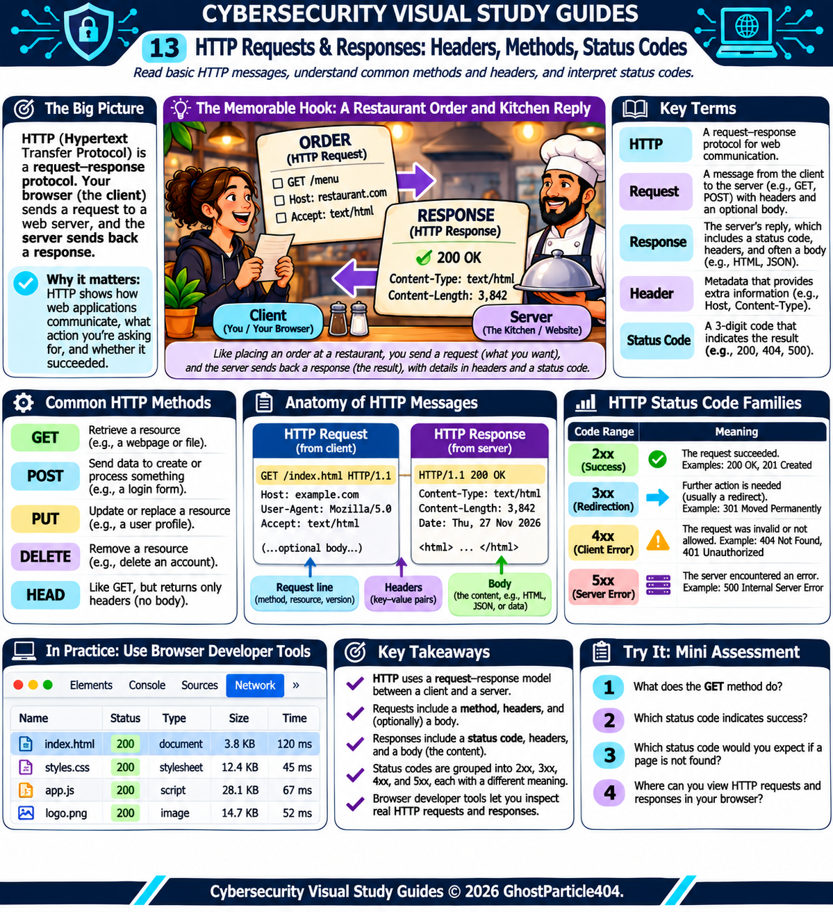

# 13 — HTTP Requests & Responses: Headers, Methods, Status Codes

**Cybersecurity Visual Study Guides · 02 — Web & Internet Security**  
**Estimated learning time:** 25–30 minutes, including practice

Every time you load a webpage, submit a form, or use a web application, your browser and a server exchange messages. This lesson will help you read those messages, explain what each part means, and use browser developer tools to investigate what happened.

## Why this matters

A login form appears to do nothing. Is the browser failing to send a request? Did the server reject it? Did the server redirect you? HTTP messages give you evidence rather than guesses. Security analysts, developers, incident responders, and testers examine HTTP traffic to understand application behavior and identify suspicious activity.

## Learning objectives

By the end, you should be able to:

1. **Identify** the request method, target, headers, and optional body in an HTTP message.
2. **Interpret** the response status, headers, and optional body.
3. **Compare** GET, POST, PUT, DELETE, and HEAD without assuming a method guarantees a particular outcome.
4. **Classify** common HTTP status codes into 2xx, 3xx, 4xx, and 5xx families.
5. **Inspect and explain** a request–response exchange using browser developer tools.

## The big picture, in plain English

**HTTP (Hypertext Transfer Protocol)** is an application-layer request–response protocol. A client, often your browser, sends a request describing what it wants to do with a resource. A server responds with a status and, when appropriate, content. HTTP is used for much more than HTML pages: APIs, images, scripts, and many other resources use it too.

**HTTPS** is HTTP carried over a secure connection using TLS. The HTTP concepts in this lesson still apply; TLS changes how the messages are protected in transit, not the basic meaning of methods or status codes. See [Guide 11 — HTTP vs. HTTPS](11-http-vs-https.md) and [Guide 12 — TLS Handshake](12-tls-handshake.md).

## A memorable story: the restaurant order slip

You sit down at a restaurant and request the soup. Your order slip identifies **what you want**; the waiter may also include preferences, such as “no dairy.” The kitchen receives the order and sends back a result: soup delivered, dish unavailable, or an unexpected problem in the kitchen.

Think of the **client** as the customer, the **server** as the kitchen, the **request** as the order slip, and the **response** as the kitchen's reply. A status code is a standardized shorthand for the result. Headers carry useful details about the order or response. The body can contain the submitted information or the food itself, depending on which direction the message travels.

### Where the analogy stops working

An HTTP method is not a promise that the server will behave properly. A GET request *should* be safe under HTTP semantics, but a badly designed application might still change data. A `200 OK` response does not prove that the content is accurate, harmless, or authorized. Unlike a restaurant, HTTP also includes caching, intermediaries, redirects, and machine-readable representations.

## Translate the story into technical reality

| Restaurant story | HTTP concept | Why it matters |
|---|---|---|
| Customer | Client (browser or application) | Initiates the request |
| Kitchen | Server | Processes the request and returns a response |
| Order type | Method (`GET`, `POST`, etc.) | Expresses the intended operation |
| Requested dish | Target path, such as `/menu` | Identifies the requested resource |
| Order notes | Request headers | Supply context such as accepted content types |
| Order details | Request body, when present | Carries submitted data |
| Kitchen reply | Response status | Indicates the outcome at the HTTP level |
| Served dish | Response body, when present | Contains the returned representation or data |

## How it actually works — step by step

### 1. The browser constructs a request

Here is a simplified **HTTP/1.1** request, shown in its readable wire format:

```http
GET /menu HTTP/1.1
Host: restaurant.example
Accept: text/html
User-Agent: ExampleBrowser/1.0

```

- **Request line:** `GET` is the method, `/menu` is the target, and `HTTP/1.1` is the protocol version.
- **Headers:** `Host` identifies the target host; `Accept` indicates a preferred response media type; `User-Agent` identifies the client software.
- **Blank line:** Separates the header section from any message body.
- **Body:** This GET example has none.

**Important:** HTTP/2 and HTTP/3 use different on-the-wire framing, including pseudo-headers, rather than this literal HTTP/1.1 text layout. Browser developer tools often present a readable, normalized view of the same concepts.

### 2. The server responds

```http
HTTP/1.1 200 OK
Content-Type: text/html; charset=utf-8
Cache-Control: no-store

<h1>Today's menu</h1>
```

- **Status line:** `200 OK` indicates successful handling of this request.
- **Response headers:** `Content-Type` identifies the representation; `Cache-Control` gives caching instructions.
- **Response body:** Here, HTML that the browser can render.

The examples are illustrative, not captured traffic. Real responses can contain additional headers and may be compressed, chunked, or transmitted using HTTP/2 or HTTP/3.

### 3. The browser may make more requests

The HTML page can refer to stylesheets, scripts, fonts, and images. Each resource can produce another request and response. A single page load may therefore involve many exchanges, not just one.

### 4. Methods express intended operations

| Method | Intended semantics | Example | Important nuance |
|---|---|---|---|
| `GET` | Retrieve a representation | Load `/menu` | Defined as safe and idempotent; a server implementation can still be flawed |
| `POST` | Submit data for processing | Send a login form | Not inherently “create”; may perform many types of processing |
| `PUT` | Create or replace the state of a target resource | Replace `/profile/42` | Idempotent by specification, even if the response differs |
| `DELETE` | Request removal of the target resource's association | Delete `/draft/7` | Idempotent in intended effect; success does not guarantee immediate physical erasure |
| `HEAD` | Request response metadata without response content | Check a resource's headers | Similar to GET, but the server does not send response content |

**Safe** means a method is intended for read-only behavior. **Idempotent** means repeating an identical request has the same intended effect as making it once. These are protocol semantics, not guarantees about an application's correctness or security.

### 5. Headers provide context

| Header | Direction | Typical purpose |
|---|---|---|
| `Host` | Request (HTTP/1.1) | Identifies the requested host |
| `Accept` | Request | Indicates acceptable response media types |
| `Content-Type` | Either | Identifies the media type of content in the message |
| `Authorization` | Request | Carries credentials or an authorization token when used |
| `Cookie` | Request | Sends applicable cookies to the server |
| `Set-Cookie` | Response | Instructs the browser to store or update a cookie |
| `Location` | Response | Provides a URI, often for redirection |
| `Cache-Control` | Either | Communicates caching directives |

**Headers are metadata, not proof of safety.** For example, a request carrying an `Authorization` header does not establish that the server authorized the requested operation.

### 6. Status codes summarize the result

| Family | General meaning | Examples |
|---|---|---|
| **1xx** | Informational | `100 Continue` |
| **2xx** | Successful | `200 OK`, `201 Created`, `204 No Content` |
| **3xx** | Redirection | `301 Moved Permanently`, `302 Found`, `304 Not Modified` |
| **4xx** | Client-side request problem | `400 Bad Request`, `401 Unauthorized`, `403 Forbidden`, `404 Not Found`, `429 Too Many Requests` |
| **5xx** | Server-side failure | `500 Internal Server Error`, `502 Bad Gateway`, `503 Service Unavailable` |

**Three distinctions worth remembering:**

- `401 Unauthorized` usually means valid authentication credentials are missing or insufficient; despite its name, it concerns **authentication**. `403 Forbidden` means the server understood the request but refuses to fulfill it.
- `404 Not Found` means the server cannot find—or will not disclose—the requested resource. It does not prove the resource never existed.
- `304 Not Modified` is a cache-validation response, **not** a conventional redirect to a different page.

### 7. Follow one complete exchange

Suppose you navigate to `https://restaurant.example/menu`:

1. The browser establishes the necessary connection, including TLS for HTTPS.
2. It sends `GET /menu` with request headers.
3. The server returns `200 OK`, a `Content-Type`, and HTML.
4. The browser parses the HTML and requests any linked resources.
5. Developer tools show the exchanges, including their status codes and timings.

A response status tells you what the server reported at the HTTP level; you still need to inspect the body and application behavior to understand the full result.

## Essential terminology

| Term | Plain-English meaning | Example or implication |
|---|---|---|
| **HTTP** | Hypertext Transfer Protocol | Web client–server messages |
| **HTTPS** | HTTP protected with TLS | Protects HTTP traffic in transit |
| **Client** | Software initiating requests | Browser, mobile app, API client |
| **Server** | Software handling requests | Web or API server |
| **Method** | Intended operation | `GET`, `POST` |
| **Resource** | Thing identified by a URI | `/account/settings` |
| **Header** | Metadata field | `Content-Type: application/json` |
| **Body** | Optional message content | JSON payload or HTML response |
| **Status code** | Three-digit result classification | `404` |
| **Redirect** | Response directing the client elsewhere | `302` with `Location` |
| **Cookie** | Small state value stored by a browser | Session identifier |
| **DevTools** | Browser developer tools | Network panel |

## Real-world cybersecurity application: investigating a login failure

**Situation:** A user submits a login form, but the page does not advance.

**Evidence collection (authorized environment):** Open the browser's Network panel, reproduce the issue with a test account, and inspect the request to the login endpoint. Avoid copying passwords, session cookies, or tokens into notes or screenshots.

**What to check:**

1. **Was a request sent?** If no request appears, investigate client-side behavior, filters, and whether the form actually submitted.
2. **What method and target were used?** A login endpoint commonly uses POST, but this is application-specific.
3. **What status returned?** `401` may indicate an authentication failure; `403` may indicate a refusal; `500` indicates a server-side error. The application's documented behavior matters.
4. **Did a redirect occur?** A `302` or `303` may send the browser to another page. Follow the request chain.
5. **Did the server return an error body?** A JSON error or HTML message may explain the outcome, but treat the message as evidence to evaluate, not definitive proof of the cause.

**Defensible conclusion:** If a request is sent and the server responds `401`, you have evidence of an HTTP authentication-related rejection. You do **not** yet know whether the root cause is an incorrect password, an expired session, a misconfiguration, or another condition. Correlate with application logs and documented behavior where authorized.

### Try it: inspect your browser's network traffic

Use a public website you trust or an application you own or are authorized to test.

1. Open the site in Chrome or Firefox.
2. Open **Developer Tools** (often `F12`, or via the browser menu).
3. Select the **Network** tab, then reload the page.
4. Select the main document request.
5. Find the **request method**, **request URL**, **status code**, **request headers**, and **response headers**.
6. Look for one image, stylesheet, or script request and compare it with the main document request.
7. If available, inspect the **Response** or **Preview** tab. Avoid sharing sensitive values.

**Expected observation:** You will generally see multiple requests with methods, status codes, timing information, and headers. The exact labels vary by browser, HTTP version, and site.

**Optional challenge:** Find a redirect chain or a `304 Not Modified` response. Neither is guaranteed on a particular site or reload.

## Common misconceptions and pitfalls

| Myth | More accurate explanation |
|---|---|
| “POST always creates a resource.” | POST requests processing; creation is only one possible outcome. |
| “GET requests cannot change anything.” | GET is defined as safe, but applications may violate the intended semantics. |
| “A 200 response means the website is safe.” | It indicates HTTP-level success, not that content is benign or access was appropriate. |
| “401 means forbidden and 403 means unauthenticated.” | Typically, 401 concerns missing/invalid authentication; 403 is a refusal to fulfill the request. |
| “Every HTTP request has a body.” | Bodies are optional; many GET and HEAD requests have none. |

## Check your understanding

**1.** In an HTTP request, which part tells the server the intended operation: method, header, or status code?

**2.** Identify the method, target, and version in `GET /reports HTTP/1.1`.

**3.** A browser receives `201 Created` after submitting a form. Which status-code family is this, and what does it indicate?

**4. Scenario:** A browser requests `/old-page` and receives `301 Moved Permanently` with a `Location` header. What would you expect the browser to do next?

**5. Scenario:** A test account submits a login request and receives `401 Unauthorized`. What can you conclude, and what *can't* you conclude yet?

**6.** Explain the difference between a request header and a response body, using a concrete example.

**7. Scenario:** A user says a webpage loaded successfully, but an image is missing. How could the Network tab help you investigate? Name at least three things you would inspect and explain why.

## Answer key with explanations

<details>
<summary>Show answers and explanations</summary>

**1. Method.** The method, such as `GET` or `POST`, expresses the intended operation. Status codes appear in responses.

**2.** Method: `GET`; target: `/reports`; version: `HTTP/1.1`. These three elements form the HTTP/1.1 request line.

**3.** `201` belongs to **2xx (successful)** and indicates that the request was fulfilled and resulted in creation of one or more resources. You may need response headers or content to identify the created resource.

**4.** The browser will ordinarily follow the redirect to the URI indicated by `Location`, subject to browser behavior and security rules. The 301 response itself is not the final page content.

**5.** The server returned an authentication-related HTTP rejection. You cannot infer the precise underlying cause from the status code alone; inspect the application's documented responses and authorized logs.

**6.** A request header supplies metadata sent by the client, such as `Accept: application/json`. A response body contains returned content, such as a JSON object or an HTML page. Headers and bodies serve different roles.

**7.** Locate the image request, check whether it was sent, inspect its **status code**, **request URL**, **response content type**, and possibly the **response body** or **timing**. A `404` suggests the requested resource was not found or disclosed; a `403` suggests refusal; a `200` with an unexpected content type may indicate the wrong resource. None of these alone proves the root cause.

</details>

## Teach it back in 60 seconds

Without looking at the lesson, explain:

1. How an HTTP request differs from an HTTP response.
2. What a method, header, body, and status code each contribute.
3. How you would interpret `200`, `301`, `404`, and `500`.
4. Where you would look in your browser to investigate a failed request.

## Key takeaways

- **HTTP is a request–response protocol:** clients ask; servers report an outcome and may return content.
- **Methods describe intended operations**, but actual application behavior must be verified.
- **Headers provide metadata; bodies carry optional content.**
- **Status-code families help narrow an investigation**, but do not independently establish root cause or security.
- **Browser developer tools make HTTP exchanges observable**, supporting troubleshooting and authorized security analysis.

## Further learning and references

**Primary references**

- [RFC 9110 — HTTP Semantics](https://www.rfc-editor.org/rfc/rfc9110) — methods, status codes, fields, and core semantics.
- [RFC 9112 — HTTP/1.1](https://www.rfc-editor.org/rfc/rfc9112) — HTTP/1.1 message syntax and framing.
- [RFC 9113 — HTTP/2](https://www.rfc-editor.org/rfc/rfc9113) — HTTP/2 framing and message representation.
- [RFC 9114 — HTTP/3](https://www.rfc-editor.org/rfc/rfc9114) — HTTP over QUIC.

**Optional practice and documentation**

- [MDN — HTTP overview](https://developer.mozilla.org/en-US/docs/Web/HTTP/Overview)
- [MDN — Network Monitor (Firefox)](https://firefox-source-docs.mozilla.org/devtools-user/network_monitor/)
- [Chrome DevTools — Network features](https://developer.chrome.com/docs/devtools/network/)

**Related guides**

- [11 — HTTP vs. HTTPS](11-http-vs-https.md)
- [12 — TLS Handshake](12-tls-handshake.md)

---

© 2026 GhostParticle404.
