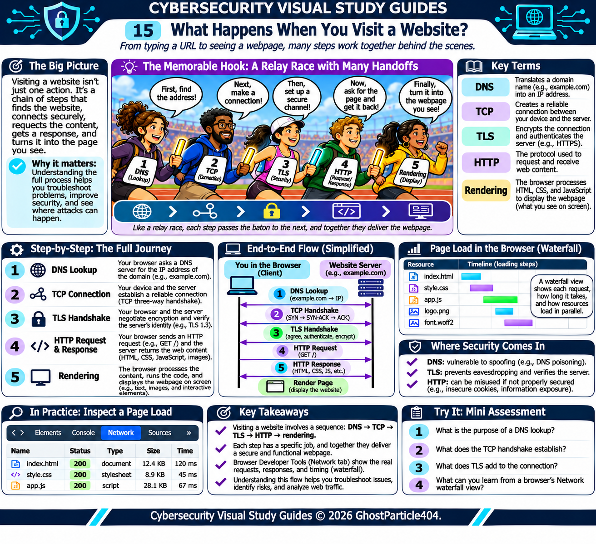

# 15 — What Happens When You Visit a Website?

**Cybersecurity Visual Study Guides · 02 — Web & Internet Security**  
**Estimated learning time:** 25–30 minutes, including practice

You type a web address, press Enter, and a page appears. Behind that familiar action, several different systems cooperate: name resolution, network transport, encryption, application requests, and browser rendering. This lesson follows one visit from beginning to end—and shows how to find the evidence for each stage.

## Why this matters

A webpage that fails to load is not one problem with one solution. The browser might be unable to resolve a name, establish a connection, validate a certificate, receive a useful HTTP response, or render the content it received. Knowing the stages helps you locate failures and interpret what network tools actually show. Security analysts use the same sequence when investigating unusual destinations, certificate warnings, redirects, and suspicious web requests.

## Learning objectives

By the end, you should be able to:

1. **Trace** a typical HTTPS page load from URL entry through rendering.
2. **Explain** the distinct roles of DNS, transport, TLS, HTTP, and browser rendering.
3. **Interpret** basic browser Network-panel evidence, including status codes, timing, and resource dependencies.
4. **Diagnose** which stage might be failing in a realistic troubleshooting scenario.
5. **Identify** security considerations and limitations at each stage.

## The big picture, in plain English

A URL identifies a resource. To fetch it, the browser generally needs a network destination, a way to exchange data with that destination, and a request describing the resource it wants. The server returns a response; the browser then interprets the response and often requests additional resources such as stylesheets, scripts, images, and fonts.

A useful teaching sequence for a **new HTTPS connection over TCP** is:

```text
Enter URL
   ↓
DNS lookup (if an address is not already available)
   ↓
TCP connection (if a new TCP connection is needed)
   ↓
TLS handshake (for HTTPS over TCP)
   ↓
HTTP request → HTTP response
   ↓
Parse, execute, lay out, paint, and display the page
   ↳ Additional requests may occur throughout rendering
```

**Important qualification:** This is a conceptual sequence, not a universal wire trace. Cached DNS results, reused connections, proxies, service workers, HTTP/2 multiplexing, and HTTP/3 over QUIC can change or eliminate steps. HTTP/3 uses QUIC over UDP rather than a separate TCP handshake; TLS 1.3 is integrated into QUIC's connection establishment.

## A memorable story: the relay race

Picture a five-person relay team trying to deliver a finished webpage.

- **Runner 1 — DNS:** Finds the correct venue address.
- **Runner 2 — Transport:** Establishes a working route for exchanging information.
- **Runner 3 — TLS:** Establishes protected communication and checks the server's identity.
- **Runner 4 — HTTP:** Requests the page and receives the server's reply.
- **Runner 5 — Rendering:** Turns the returned resources into something you can see and use.

Each runner handles a different task. If the first runner has the wrong address, the others may never get started. If the HTTP runner receives a `404 Not Found`, the connection may be working perfectly even though the requested resource is missing.

### Where the analogy stops working

Real browsers do **not** always complete these steps once, in a strict line. DNS and connections may be cached; requests can overlap; a browser may load resources from a service worker or local cache; scripts can trigger more requests after the page appears. A waterfall is closer to a relay race with several runners moving simultaneously than one baton moving neatly from start to finish.

## Translate the story into technical reality

| Story element | Real technical concept | Why it matters |
|---|---|---|
| Finding the venue | Domain Name System (DNS) resolution | Determines an address or other connection information for the destination |
| Establishing the route | TCP connection or QUIC connection | Carries exchanges between endpoints |
| Agreeing on protected communication | Transport Layer Security (TLS) | Provides encryption, integrity protection, and server authentication when correctly validated |
| Placing and receiving the order | HTTP request and response | Identifies the requested resource and returns a status, headers, and possibly a body |
| Assembling the final presentation | Browser parsing, styling, scripting, layout, and painting | Produces the displayed, interactive page |

## How it actually works — step by step

We'll follow a first visit to `https://www.example.com/` as an **illustrative** example. The address is a documentation domain; the steps and sample messages below are explanatory, not a captured session.

### 1. Interpret the URL

The browser parses the scheme (`https`), hostname (`www.example.com`), path (`/`), and any query or fragment. HTTPS normally uses port **443** unless a different port is specified. The browser may first apply policies such as HTTPS upgrades, cache rules, or service-worker interception.

### 2. Resolve the destination

If it needs an address, the browser or operating system consults available caches and a DNS resolver. A DNS answer might supply an **A** record (IPv4) or **AAAA** record (IPv6). Modern discovery can involve other DNS records and connection hints.

```text
Hostname: www.example.com
DNS query: A and/or AAAA
Result: one or more addresses (illustrative)
```

DNS tells the client where to attempt a connection; it does not by itself prove the destination is trustworthy. Standard DNS queries are not necessarily encrypted, although DNS-over-HTTPS and DNS-over-TLS can protect the resolver exchange.

### 3. Establish transport

For HTTPS over **HTTP/1.1 or HTTP/2 on TCP**, a new TCP connection typically begins with:

```text
Client → Server: SYN
Server → Client: SYN-ACK
Client → Server: ACK
```

This establishes TCP state for a reliable, ordered byte stream. Existing connections can be reused, so a new handshake is not required for every resource.

For **HTTP/3**, the browser uses QUIC over UDP; do not expect the TCP three-way handshake in that case.

### 4. Establish TLS protection

For a typical full **TLS 1.3 handshake over TCP**:

1. The client sends **ClientHello**, offering supported cryptographic parameters and usually an ephemeral key share.
2. The server sends **ServerHello** with selected parameters and its key share.
3. Both sides derive handshake secrets. The server then sends encrypted handshake messages, including its **Certificate**, **CertificateVerify**, and **Finished** messages in a certificate-authenticated handshake.
4. The client validates the certificate chain and hostname, verifies the server's proof of key possession and Finished message, and sends its own **Finished** message.
5. Protected application data can be exchanged using derived traffic keys.

TLS helps prevent eavesdropping and tampering in transit. It does **not** guarantee that the website's content is honest or harmless. Some resumed connections and optional TLS features have different message patterns; this is the ordinary full-handshake teaching case.

### 5. Exchange HTTP messages

An illustrative HTTP/1.1 request looks like this:

```http
GET / HTTP/1.1
Host: www.example.com
Accept: text/html

```

An illustrative response might be:

```http
HTTP/1.1 200 OK
Content-Type: text/html; charset=utf-8

<!doctype html>
<html><head><title>Example</title></head>
<body><h1>Hello!</h1></body></html>
```

**GET** requests a resource; **200 OK** means this request succeeded. Other responses might redirect the browser (`3xx`), report a client-side request problem (`4xx`), or indicate a server-side failure (`5xx`). The readable start-line format shown here is specific to HTTP/1.1; HTTP/2 and HTTP/3 encode HTTP messages differently while retaining comparable request/response semantics.

### 6. Render the page

The browser parses HTML into a **Document Object Model (DOM)** and CSS into styling information, combines relevant information to determine layout, and paints pixels to the screen. JavaScript can modify the DOM, react to user actions, and fetch more data. Images, fonts, stylesheets, and scripts may require additional requests.

Rendering is **not** a single final step that waits for all network traffic to finish. A page can become visible before all images load, and additional network requests can continue afterward.

### 7. Read the waterfall

A simplified Network-panel view might show:

| Resource | Type | Status | What it contributes |
|---|---|---|---|
| `/` | Document | `200` | Initial HTML |
| `/styles.css` | Stylesheet | `200` | Visual styling |
| `/app.js` | Script | `200` | Interactive behavior |
| `/logo.png` | Image | `200` | Visual asset |
| `/api/items` | Fetch/XHR | `200` | Data requested by the application |

These are **illustrative** resources and statuses, not guaranteed results from any particular website. In a real waterfall, bars show when requests begin, how long phases take, and which requests overlap. Timing details depend on the browser and protocol; reused connections often have no fresh DNS, TCP, or TLS timing for that request.

## Essential terminology

| Term | Plain-English meaning | Example or implication |
|---|---|---|
| URL | Uniform Resource Locator identifying a resource | `https://www.example.com/` |
| DNS | Domain Name System; resolves names and other service information | A hostname resolves to an IP address |
| A / AAAA | DNS records for IPv4 / IPv6 addresses | A browser may try either address family |
| TCP | Transmission Control Protocol; reliable, ordered byte stream | Often transports HTTP/1.1 and HTTP/2 |
| QUIC | Encrypted transport protocol built over UDP | Used by HTTP/3 |
| TLS | Transport Layer Security; protects data in transit | TLS 1.3 protects HTTPS exchanges |
| Certificate | Credential containing a public key and identity information | Browser validates hostname and trust chain |
| HTTP | Hypertext Transfer Protocol; web request/response semantics | `GET /`, `200 OK` |
| Header | Metadata in a request or response | `Content-Type: text/html` |
| DOM | Document Object Model; browser representation of a document | JavaScript can update page elements |
| Rendering | Turning document, style, and other resources into displayed content | Layout and paint produce visible output |
| Waterfall | Timeline of network resource requests | Helps locate slow or failed loads |
| Cache | Stored information that may avoid a fresh lookup or download | A resource may load without a new request |

## A realistic cybersecurity application: a page that partly loads

**Situation:** A staff member says a company dashboard opens but its data table stays empty.

**Evidence:** In an authorized browser session, the analyst opens Developer Tools → Network, reloads the page, and observes that the document and stylesheet return `200`, while a request to `/api/reports` returns `403 Forbidden`.

**Reasoning:** Name resolution, transport, TLS, and at least some HTTP requests are working. The failure is associated with the API request, not proof of a DNS outage. A `403` means the server understood the request but refused to fulfill it; possible causes include authorization rules, missing permissions, or application policy. The status alone does not identify which cause applies.

**Defensible conclusion:** Investigate the request's authentication context, the user's authorized permissions, relevant response headers, and server-side logs. Do not bypass access controls or copy sensitive credentials into screenshots or public reports.

**Security connections across the journey:**

- **DNS:** Spoofed or maliciously altered resolution can direct users toward the wrong destination.
- **Transport/TLS:** Certificate warnings and protocol failures may indicate configuration problems or interception attempts; investigate rather than automatically dismissing them.
- **HTTP:** Redirects, cookies, authentication headers, and unexpected responses may reveal application issues or attack activity.
- **Rendering:** Untrusted scripts and unsafe handling of page content can create client-side risks, including cross-site scripting.

## Common misconceptions and pitfalls

| Myth | More accurate explanation |
|---|---|
| “Every page load begins with a DNS lookup.” | Cached results or other mechanisms can avoid a new lookup. |
| “Every HTTPS website uses TCP.” | HTTP/3 uses QUIC over UDP. |
| “HTTPS means the website is safe.” | TLS protects the connection; malicious sites can also use valid certificates. |
| “A `200` response means the page works.” | The document may succeed while scripts, API calls, or rendering fail. |
| “The browser downloads everything and then renders.” | Loading and rendering overlap; scripts can initiate later requests. |

## Check your understanding

1. Put these stages in a reasonable teaching order for a **new HTTPS-over-TCP connection**: HTTP exchange, DNS resolution, rendering, TLS handshake, TCP connection.
2. What information does a DNS lookup usually help the browser obtain?
3. What is the main difference between the roles of TCP and TLS?
4. **Scenario:** The main HTML request returns `200`, but an image returns `404`. Which part of the journey is demonstrably working, and what should you investigate?
5. **Scenario:** A browser shows a certificate hostname mismatch. Which stage is affected, and why should you not simply click through the warning?
6. Why might a request in a waterfall show no separate DNS or connection-establishment timing? Explain your reasoning.
7. A learner says, “The five runners always act one after another, so HTTP/3 must use a TCP handshake too.” Identify **two** problems with that statement.

## Answer key with explanations

<details>
<summary>Show answers and explanations</summary>

**1.** DNS resolution → TCP connection → TLS handshake → HTTP exchange → rendering. This is a useful model for a new HTTPS-over-TCP connection, but actual page loading can overlap or reuse prior work.

**2.** Typically an IP address (IPv4 or IPv6) for the destination, though DNS can also provide other records and connection information. A name alone is not the network address used to contact the server.

**3.** TCP provides a reliable, ordered byte stream between endpoints. TLS provides cryptographic protection and, in ordinary HTTPS, server authentication over the underlying transport. They solve different problems.

**4.** The browser successfully obtained the HTML document, so at least that request's network and HTTP path worked. Investigate the missing image URL, server resource path, access policy, and response details; a `404` does not by itself imply a broken connection.

**5.** TLS server authentication/certificate validation. A mismatch means the certificate does not correctly identify the requested hostname; proceeding may expose data to an unintended endpoint or an attacker. Confirm the URL and report the issue.

**6.** The browser may have cached DNS information or reused an existing connection. The absence of a visible timing phase is not proof that DNS or transport are unnecessary; they may have been completed earlier.

**7.** First, network requests and rendering can overlap, and cached or reused resources may skip work. Second, HTTP/3 uses QUIC over UDP, not a TCP three-way handshake. The five-stage relay is a mental model, not a universal protocol trace.

</details>

## Teach it back in 60 seconds

Without looking at the diagram, explain:

1. What happens between entering a hostname and sending the first HTTP request?
2. What separate problems do transport and TLS solve?
3. Why can a page display correctly while one API request fails?
4. What would you look for first in a Network-panel waterfall if a page seemed slow?

Aim for a connected explanation rather than five memorized definitions.

## Key takeaways

1. **A page load is a coordinated process:** resolution, transport, security, HTTP, and rendering each contribute something different.
2. **The stages are not always strictly sequential:** caching, connection reuse, parallel requests, and HTTP/3 change the actual trace.
3. **TLS protects communication, not website trustworthiness:** certificate validation matters, but HTTPS does not certify safe content.
4. **HTTP success is not the same as a successful user experience:** dependent resources and client-side code can still fail.
5. **The Network waterfall provides evidence:** use request URLs, statuses, timings, and initiators to narrow an investigation.

## Further learning and references

**Primary references**

- [RFC 9110 — HTTP Semantics](https://www.rfc-editor.org/rfc/rfc9110)
- [RFC 9114 — HTTP/3](https://www.rfc-editor.org/rfc/rfc9114)
- [RFC 9000 — QUIC: A UDP-Based Multiplexed and Secure Transport](https://www.rfc-editor.org/rfc/rfc9000)
- [RFC 8446 — The Transport Layer Security (TLS) Protocol Version 1.3](https://www.rfc-editor.org/rfc/rfc8446)
- [MDN — How the web works](https://developer.mozilla.org/en-US/docs/Learn_web_development/Getting_started/Web_standards/How_the_web_works)
- [MDN — Network Monitor](https://firefox-source-docs.mozilla.org/devtools-user/network_monitor/)

**Optional, safe practice:** Open Developer Tools on a website you are authorized to inspect, select the Network tab, reload, and compare the document request with its stylesheet and image requests. Record only non-sensitive observations. Browser controls and labels vary by version.

**Related guides**

- [06 — DNS Lookup](../01-networking-fundamentals/06-dns-url-resolution.md)
- [04 — TCP Three-Way Handshake](../01-networking-fundamentals/04-tcp-three-way-handshake.md)
- [11 — HTTP vs. HTTPS](11-http-vs-https.md)
- [12 — TLS Handshake](12-tls-handshake.md)
- [13 — HTTP Requests & Responses](13-http-requests-responses.md)

---

© 2026 GhostParticle404.
